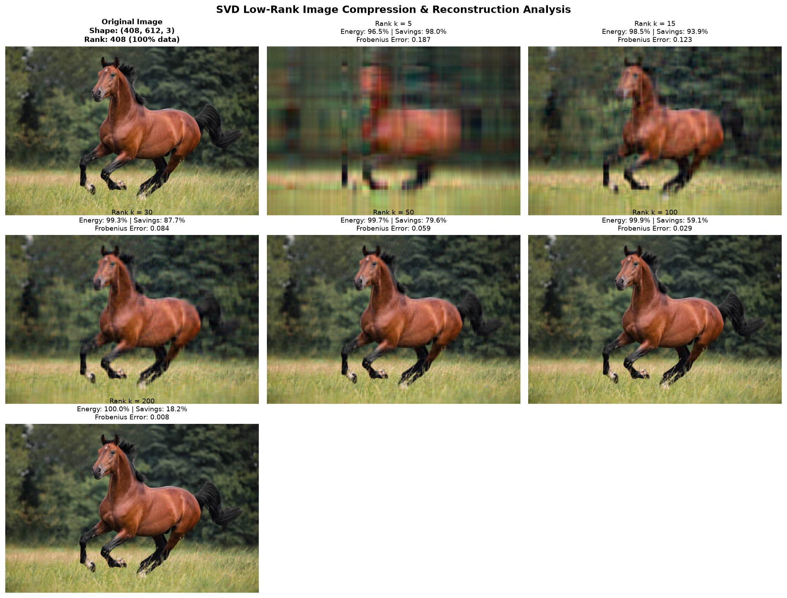
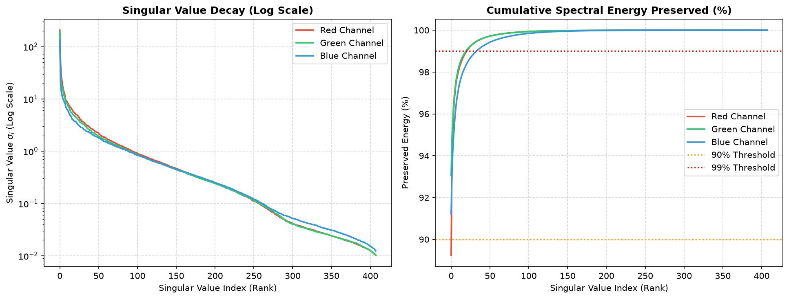
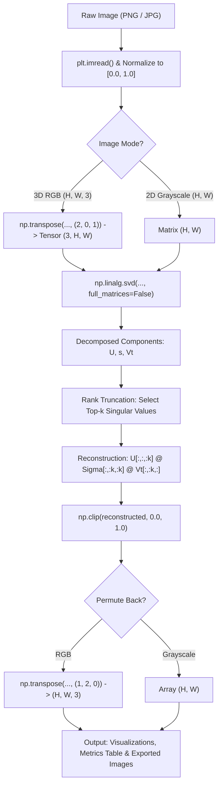

# Low-Rank Image Compression via Singular Value Decomposition (SVD)

>A high-performance Python implementation that compresses 2D grayscale and 3D RGB images through low-rank matrix approximation using NumPy vectorization, tensor axis permutation, and Singular Value Decomposition (SVD) with zero explicit loops.

[](https://www.python.org/)
[](https://numpy.org/)
[](https://matplotlib.org/)
[](LICENSE)
[](assets/jetbrains_numpy_certificate.png)

---

## 📜 Certificate & Course Completion

This portfolio project originated from the **JetBrains Academy** course:  
**"Mastering Python Libraries – NumPy"**

<p align="center">
  
</p>

---

## 🎯 Visual Demonstration & Results

Below is the side-by-side reconstruction of `horse.jpg` (resolution: $408 \times 612 \times 3$, max rank $= 408$) at progressive rank truncation levels $k \in \{5, 15, 30, 50, 100, 200\}$:

<p align="center">
  
</p>

### Singular Value Spectrum & Energy Decay
Singular values decay exponentially. A tiny subset of singular vectors captures over 99% of visual luminance and structural variance:

<p align="center">
  
</p>

### Empirical Compression Performance

| Truncated Rank ($k$) | Stored Elements | Compression Ratio | Space Savings | Spectral Energy Preserved | Relative Frobenius Error | Visual Fidelity |
| :---: | :---: | :---: | :---: | :---: | :---: | :--- |
| **Original ($k=408$)** | 749,088 | 1.00x | 0.0% | 100.00% | 0.0000 | Full resolution |
| **$k = 200$** | 612,600 | 1.22x | 18.2% | 99.99% | 0.0076 | Visually indistinguishable |
| **$k = 100$** | 306,300 | 2.45x | 59.1% | 99.92% | 0.0287 | Near-lossless details |
| **$k = 50$** | 153,150 | 4.89x | **79.6%** | **99.66%** | **0.0585** | Sharp contours, minor smoothing |
| **$k = 30$** | 91,890 | 8.15x | **87.7%** | **99.29%** | **0.0845** | Good overall shape & color |
| **$k = 15$** | 45,945 | 16.30x | **93.9%** | **98.50%** | **0.1226** | Moderate blur, recognizable |
| **$k = 5$** | 15,315 | **48.91x** | **98.0%** | **96.51%** | **0.1869** | Coarse color blocks |

---

## ⚡ Key Features / Capabilities

- **Vectorized Multi-Dimensional SVD (Zero Loops):**  
  Uses `np.transpose(img, (2, 0, 1))` to reshape the 3D tensor from $(H, W, C)$ to $(C, H, W)$. This allows `np.linalg.svd` to batch-process all three RGB channels simultaneously in optimized BLAS/LAPACK C/Fortran routines without Python `for` loops.
- **Dynamic Rank Truncation:**  
  Slice matrices $U_{:, :, :k}$, $s_{:, :k}$, and $V^T_{:, :k, :}$ dynamically for any arbitrary target rank $k \le \min(H, W)$.
- **Dual Reconstruction Engines:**  
  1. *Course pedagogical method:* constructs block diagonal $\Sigma$ using `np.fill_diagonal` followed by 3D batched `@` matrix multiplications.  
  2. *Production broadcast method:* computes $(U_k \odot s_k) \mathbin{\texttt{@}} V^T_k$ using NumPy broadcasting to prevent allocating large zero-padded $\Sigma$ matrices.
- **Precision Guarding (Floating-Point Drift):**  
  Matrix decompositions on floating-point numbers accumulate rounding variances (e.g. $-10^{-16}$ or $1.0000000002$). The engine applies `np.clip(..., 0.0, 1.0)` to eliminate visual artifacting and warnings during rendering.
- **Automated Compression & Energy Metrics:**  
  Computes parameter reduction ratios, space savings percentage, relative Frobenius norm reconstruction error ($\|A - A_k\|_F / \|A\|_F$), and cumulative spectral energy.
- **Dual Codebase Structure:**  
  Includes both the modular object-oriented production engine (`src/svd_compressor.py`) and the original task script completed for the JetBrains Academy curriculum (`original_jetbrains_task.py`).

---

## 🧠 Mathematical Foundation

### 1. Matrix Factorization
For any real matrix $A \in \mathbb{R}^{m \times n}$ with rank $r \le \min(m, n)$, Singular Value Decomposition factorizes $A$ into:

$$A = U \Sigma V^T$$

Where:
- $U \in \mathbb{R}^{m \times m}$ is an orthogonal matrix whose columns are the left-singular vectors (eigenvectors of $A A^T$).
- $\Sigma \in \mathbb{R}^{m \times n}$ is a rectangular diagonal matrix containing singular values $\sigma_1 \ge \sigma_2 \ge \dots \ge \sigma_r \ge 0$ (square roots of non-zero eigenvalues of $A^T A$).
- $V^T \in \mathbb{R}^{n \times n}$ is an orthogonal matrix whose rows are the right-singular vectors (eigenvectors of $A^T A$).

### 2. Eckart–Young–Mirsky Theorem (Optimal Low-Rank Approximation)
The optimal rank-$k$ approximation ($k < r$) minimizing the Frobenius norm error is obtained by truncating the decomposition after the first $k$ singular values:

$$A_k = \sum_{i=1}^k \sigma_i u_i v_i^T = U_k \Sigma_k V_k^T$$

### 3. Storage Efficiency
- **Uncompressed image:** requires storing $m \times n$ values per channel.
- **Rank-$k$ SVD approximation:** requires storing only $k \times (m + n + 1)$ values per channel.
- **Break-even condition:** Compression delivers positive space savings whenever $k < \frac{m \cdot n}{m + n + 1}$.

---

## 🏗️ Architecture & Processing Pipeline



---

## 📦 Project Structure

```text
singular-value-decomposition/
├── assets/
│   ├── jetbrains_numpy_certificate.png # Verified JetBrains Academy certificate
│   ├── horse.jpg                      # Sample benchmark image (408 x 612)
│   ├── svd_compression_grid.png       # Generated rank comparison plot
│   └── singular_values_spectrum.png   # Generated spectral decay plot
├── src/
│   ├── __init__.py                    # Package exports
│   └── svd_compressor.py              # SVD engine (vectorized batching & metrics)
├── main.py                            # CLI demo and batch benchmark runner
├── original_jetbrains_task.py         # JetBrains Academy course task script
├── requirements.txt                   # Dependency specifications
├── .gitignore                         # Python/IDE ignore rules
├── LICENSE                            # MIT License
└── README.md                          # Project documentation
```

---

## 🚀 Installation & Usage

### 1. Clone & Set Up Environment

```bash
# Clone the repository
git clone https://github.com/<your-username>/<your-repo-name>.git
cd "singular value decomposition"

# Create and activate virtual environment
python -m venv .venv

# Windows (PowerShell):
.venv\Scripts\Activate.ps1
# Linux / macOS:
source .venv/bin/activate

# Install dependencies
pip install -r requirements.txt
```

### 2. Run the Benchmark & Compression Demo

```bash
# Run with default sample image and default ranks (5, 15, 30, 50, 100, 200)
python main.py

# Test on any custom image with custom k ranks
python main.py --image path/to/your/image.png --k 10 25 50 100

# Specify custom output directory
python main.py --image assets/horse.jpg --output-dir my_results/
```

### 3. Run the Original Course Task Script

```bash
python original_jetbrains_task.py
```

### 4. Use as a Python Library in Your Own Projects

```python
from src.svd_compressor import SVDImageCompressor

# Initialize compressor with any image
compressor = SVDImageCompressor("assets/horse.jpg")

# Reconstruct image at rank k = 30
compressed_array = compressor.reconstruct(k=30)

# Retrieve mathematical performance metrics
metrics = compressor.compute_metrics(k=30)
print(f"Space Saved: {metrics['space_savings_pct']:.2f}%")
print(f"Energy Retained: {metrics['energy_preserved_pct']:.2f}%")
print(f"Frobenius Error: {metrics['relative_frobenius_error']:.4f}")
```

---

## 🛠️ Tech Stack & Tools

- **Language:** Python 3.9+
- **Core Library:** NumPy (array broadcasting, vectorization, `np.linalg.svd`, `np.transpose`, `np.clip`)
- **Plotting & Imaging:** Matplotlib, Pillow
- **Linear Algebra Theory:** Singular Value Decomposition, Low-Rank Tensor Approximation, Frobenius Matrix Norms
- **Certification:** JetBrains Academy (NumPy Specialization)

---

## 📄 License

This project is licensed under the [MIT License](LICENSE).
